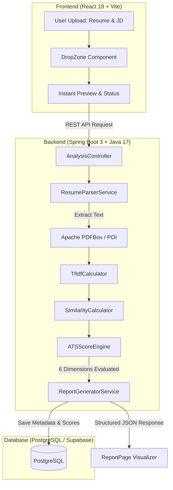

# ResumeLens

<div align="center">

[](https://github.com/Chirag1724/Resumelens/actions/workflows/ci.yml)
[](https://github.com/Chirag1724/Resumelens/releases)
[](LICENSE)
[](https://www.oracle.com/java/)
[](https://spring.io/projects/spring-boot)
[](https://react.dev/)
[](docker-compose.yml)

**Privacy-first ATS resume scoring tool and intelligence engine powered by TF-IDF, Cosine Similarity, and deterministic mathematical evaluation.**

[Features](#features) • [Architecture](#architecture) • [Quick Start](#quick-start-with-docker) • [Local Setup](#local-development-setup) • [Contributing](CONTRIBUTING.md)

</div>

---

## What It Does

ResumeLens accepts a resume (PDF or plain text) and a job description, then produces an instant, transparent compatibility score broken down across six categories: ATS formatting compliance, skills match, impact and achievements, project quality, writing quality, and professionalism.

The score reflects how well a resume performs against automated screening systems for that specific role. Alongside the score, the system identifies missing high-value keywords and generates copyable fix prompts for targeted resume improvement. Zero raw documents are permanently retained on disk.

---

## Key Features

- **In-Memory Document Ingestion**: Text extraction for PDF and DOCX files without persisting raw files.
- **Deterministic NLP Algorithms**: From-scratch Java implementations of TF-IDF, Cosine Similarity, and Levenshtein fuzzy matching.
- **6-Dimension ATS Scoring**: Transparent scoring across ATS Compatibility, Skills Validation, Impact & Metrics, Project Quality, Writing Quality, and Professionalism.
- **Keyword Gap Analysis**: Categorized breakdown of matched skills vs. missing target keywords.
- **ATS Risk Flags**: Automatic detection of parsing pitfalls, non-standard section headings, table usage, and missing contact info.
- **Interactive UI & Visualizer**: Glassmorphic dark-mode web application with real-time scan animation and SVG score gauges.
- **AI Fix-Prompt Generator**: Structured prompts ready to copy into external assistants for customized bullet-point rewriting.
- **PDF Report Export**: Downloadable evaluation summary for offline candidate or job-seeker review.

---

## Architecture



---

## Tech Stack

| Layer                   | Technology                                      | Description                                       |
| ----------------------- | ----------------------------------------------- | ------------------------------------------------- |
| **Frontend**            | React 18, Vite 6, Tailwind CSS                  | Glassmorphic SPA with responsive dark mode        |
| **Backend**             | Java 17, Spring Boot 3.2.5, Spring Security     | REST API with stateless JWT authentication        |
| **Database**            | PostgreSQL 16 (Local or Supabase)               | Relational metadata storage for analysis sessions |
| **NLP & Scoring**       | TF-IDF, Cosine Similarity, Levenshtein Distance | Pure Java deterministic algorithms                |
| **Document Processing** | Apache PDFBox, Apache POI                       | PDF and DOCX parsing and text extraction          |
| **PDF Reporting**       | iText Core 8.0.4                                | Automated exportable analysis reports             |
| **Infrastructure**      | Docker, Docker Compose, Nginx                   | Multi-stage container builds and orchestration    |

---

## Quick Start with Docker

The fastest way to run the entire ResumeLens stack locally is with Docker Compose:

```bash
# 1. Clone the repository
git clone https://github.com/Chirag1724/Resumelens.git

# 2. Launch PostgreSQL, Backend, and Frontend containers
docker compose up -d --build
```

- **Frontend App**: `http://localhost`
- **Backend REST API**: `http://localhost:8080/api/v1`
- **Interactive Swagger UI**: `http://localhost:8080/swagger-ui/index.html`
- **Health Check**: `http://localhost:8080/api/v1/health`

To stop the containers:
```bash
docker compose down
```

---

## Local Development Setup

### Prerequisites

- **Java JDK**: Version 17 or higher
- **Maven**: Version 3.8+ (wrapper `./mvnw` included)
- **Node.js**: Version 20 or higher (with npm)
- **PostgreSQL**: Version 15+ (local instance or free Supabase tier)

### Backend Setup

1. Copy the environment configuration template:
   ```bash
   cp backend/.env.example backend/.env
   ```
2. Configure your database connection in `backend/.env`:
   ```bash
   DB_URL=jdbc:postgresql://localhost:5432/resumelens
   DB_USERNAME=postgres
   DB_PASSWORD=your_password
   JWT_SECRET=your_32_character_minimum_random_secret_string
   ```
3. Run the Spring Boot application:
   ```bash
   cd backend
   ./mvnw spring-boot:run
   ```

### Frontend Setup

1. Navigate to the frontend directory:
   ```bash
   cd frontend
   npm install
   ```
2. Copy the environment template:
   ```bash
   cp .env.example .env
   ```
3. Start the Vite development server:
   ```bash
   npm run dev
   ```
   Open `http://localhost:5173` in your browser.

---

## Running Tests

All mathematical algorithms, edge cases, and endpoints are covered by comprehensive unit and integration test suites:

```bash
# Backend Test Suite (174 tests)
cd backend
./mvnw test

# Frontend Production Bundle Check
cd ../frontend
npm run build
```

---

## Algorithmic Foundation

### TF-IDF (Term Frequency - Inverse Document Frequency)
Used to weight terms in the job description by their significance relative to the resume text. Implemented directly in Java to eliminate heavyweight dependencies and ensure that term frequency calculation and IDF logarithmic dampening remain completely transparent and auditable.

### Cosine Similarity
Calculates the normalized dot product of TF-IDF vectors representing the candidate document and target job description. The resulting score is length-independent and strictly bounded between `0.0` and `1.0`.

### Levenshtein Distance
Computes single-character edit distances (insertions, deletions, substitutions) to identify skill name aliases (e.g. `Javascript` vs. `JavaScript`, `Node` vs. `Node.js`) using a calibrated threshold of 2.

---

## Community & Contributing

Contributions are welcome! Please read our [Contributing Guide](CONTRIBUTING.md) and [Code of Conduct](CODE_OF_CONDUCT.md) before submitting pull requests.

If you find a bug or have a suggestion, please open an issue using the [Issue Templates](.github/ISSUE_TEMPLATE/).

---

## Author & Maintainer

ResumeLens was created and is actively maintained by:

**Chirag Dwivedi**
- GitHub: [@Chirag1724](https://github.com/Chirag1724)
- Email: [chiragdwivediji@gmail.com](mailto:chiragdwivediji@gmail.com)

---

## License & Governance

- **License:** Distributed under the [MIT License](LICENSE).
- **Privacy Policy:** Transparent, ephemeral data handling details in [PRIVACY.md](PRIVACY.md).
- **Terms of Service:** Educational usage and disclaimer in [TERMS.md](TERMS.md).
- **Security Policy:** Coordinated vulnerability disclosure in [SECURITY.md](SECURITY.md).
